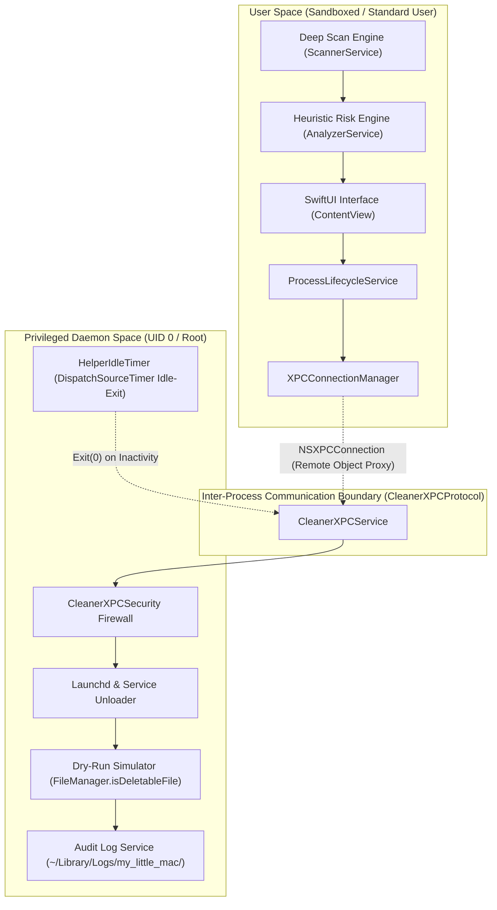

# my_little_mac

*A Security-First, Read-Only macOS Application Cleaner & Deep System Auditing Architecture*

`my_little_mac` is an advanced macOS system utility designed to locate, inspect, and simulate the removal of application remnants across all macOS subsystem layers. Rather than operating as an unconstrained cleaner script, it implements an enterprise-grade security posture centered on **zero-destruction dry-run simulations**, **heuristic risk mitigation**, and **hardened privilege isolation via an Apple `SMAppService` Privileged XPC Helper**.

---

## 1. Architecture Overview

`my_little_mac` intentionally separates user interaction from privileged system operations through macOS process isolation. The application operates across two strictly decoupled boundaries:



### Key Architectural Tenets:
- **Zero Local Privilege Escalation:** The main application (`my_little_mac.app`) runs purely in user space. It holds no root entitlements and never executes privileged commands or shell invocations directly in its own memory space.
- **Isolated Privileged Helper (`bunyamin.my-little-mac.helper`):** All privileged inspection and background daemon unloading tasks are handled by a dedicated daemon managed via Apple's modern `SMAppService.daemon(plistName:)` API.
- **Remote Execution Verification:** The main application requires cryptographic and runtime proof of execution before accepting any helper response. The helper must return its `PID` and `UID == 0` (root). If the helper returns a non-root UID (such as 501), or if communication falls back to an unverified proxy, the operation is immediately aborted.
- **Strict Data Contract:** The boundary between the scanning engines, UI, and lifecycle managers is enforced using immutable Swift structs (`[ScannedFile]`). Only after sanitization and strict validation are file paths serialized for IPC transmission.

---

## 2. Core Features

### 🔍 Deep Scan & Receipt Analysis
The scanner goes significantly beyond standard directory searches or superficial file name lookups:
- **Metadata Search (`Spotlight / mdfind`):** Queries system metadata stores for matching `kMDItemCFBundleIdentifier`.
- **macOS Receipt Database Inspection (`pkgutil` & `.bom`):** Identifies installer receipts matching the target application bundle via `pkgutil --pkgs`. For detected packages, it reads the Bill of Materials (BOM) using `pkgutil --files` to identify root-level files installed across `/Library`, `/usr/local`, and private system locations.
- **Deep Fallback Scan:** Thoroughly traverses user and global library hierarchies, including:
  - `~/Library/Application Support` and `/Library/Application Support`
  - `~/Library/Caches` and `/Library/Caches`
  - `~/Library/Preferences` and `/Library/Preferences`
  - `~/Library/Containers` & `~/Library/Group Containers`
  - `~/Library/Application Scripts`
  - `~/Library/Saved Application State`
  - `~/Library/WebKit` & `~/Library/HTTPStorages`
- **Dynamic Darwin Cache & Temp Directories:** Dynamically queries `getconf DARWIN_USER_CACHE_DIR` and `getconf DARWIN_USER_TEMP_DIR` to expose private, unindexed caches generated by macOS sandbox daemons.
- **Team ID Group Containers:** Extracts Apple Developer Team IDs and scans shared App Group containers (`~/Library/Group Containers/group.<teamID>.*`).
- **Background Task Management (BTM):** Inspects background task entries and system extension registrations linked to the target application.

### 🛡️ Heuristic Risk Engine
Files identified during the scan are submitted to the `AnalyzerService` to determine their risk profile prior to display:
- **Risk Categorization:**
  - `.safeToDelete`: Dedicated caches, configuration files, and logs strictly matching the application's unique bundle identifier.
  - `.sharedDependency`: Shared software components, parent vendor trees, or cross-platform toolchain directories.
  - `.highRisk`: System-level configurations, shared daemons, or root paths requiring elevated caution.
  - `.unknown`: Unrecognized dotfiles, third-party libraries, or ambiguous structures.
- **Cross-Platform Dotfile & Toolchain Protection:** Directories such as `~/.gradle`, `~/.m2`, `~/.npm`, and shared SDK paths are automatically classified as `.sharedDependency` or `.highRisk`. They are locked to prevent breaking external developer environments.
- **Vendor & Software Suite Resolution:** Detects whether an application is part of a larger software suite (e.g., Adobe, JetBrains, Microsoft, Google). Shared directories (e.g., `/Library/Application Support/Adobe`) are safeguarded against accidental inclusion.
- **Versioned Directory Resolution:** Automatically parses versioned directories (e.g., `~/Library/Application Support/Google/AndroidStudio2025.2.2`) and associates them with the specific release while protecting shared configurations.
- **Parent-Child Collision Resolver:** Detects hierarchical containment between parent directories and child files, eliminating redundant entries and preventing recursive deletion conflicts.

### ⚙️ Process Lifecycle & Service Management
Before initiating any simulation or cleanup preparation, active processes and services must be gracefully disconnected:
- **Live Process Termination:** Queries `NSWorkspace.shared.runningApplications` using the target application's bundle identifier. Sends a graceful termination request (`terminate()`). If the process does not terminate within 5 seconds, it enforces termination using `forceTerminate()` (SIGKILL).
- **Daemon & Agent Unloading:** Prior to dry-run verification, if the payload contains launch services (`/Library/LaunchDaemons`, `/Library/LaunchAgents`, or `~/Library/LaunchAgents`), the XPC Helper unloads the service using `SMAppService` or `launchctl bootout`. This clears macOS Background Task Management (BTM) tracking and prevents zombie restarts.

### 📝 Audit Logging & Dry-Run (No-Destruction Policy)
- **Zero-Destruction Guarantee:** The codebase contains **zero** destructive commands (`rm -rf`, `FileManager.removeItem`, `trashItem`, etc.). 
- **Dry-Run Simulation:** Every path is verified using `FileManager.default.isDeletableFile(atPath:)` and filesystem accessibility checks within the privileged helper.
- **Structured Audit Trails:** Successful simulations generate an immutable, machine-readable JSON log saved to:
  ```
  ~/Library/Logs/my_little_mac/clean_audit_[TIMESTAMP].json
  ```
  Each audit log records:
  - Scanned application bundle identifier (`CFBundleIdentifier`)
  - Target application bundle path
  - Execution timestamp (ISO 8601)
  - Operator authorization status
  - Helper Process ID (`PID`) and User ID (`UID == 0`)
  - Verification of root privilege execution
  - Exhaustive list of all approved paths
- **XPC Idle-Exit & Resource Management:** The helper daemon implements an automatic `DispatchSourceTimer` (10-second idle window) and `ProcessInfo.processInfo.beginActivity` / `os_transaction`. If no IPC requests arrive within the window, or if the main application disconnects (`invalidationHandler`), the daemon cleanly exits (`exit(0)`), preventing orphaned background memory leaks.

---

## 3. Security Posture & UI Defense Barrier

`my_little_mac` employs multiple layers of defensive programming to prevent user error or unauthorized system modifications:

### UI Security Barrier
- **Safe Defaults:** Any file evaluated as `.sharedDependency`, `.highRisk`, or `.unknown` is **never** preselected by default (`isSelectedForDeletion = false`). Only confirmed `.safeToDelete` items are selectable.
- **Explicit User Confirmation:** Attempting to toggle a `.sharedDependency` or `.highRisk` item triggers an interactive warning modal requiring explicit intent.
- **Privilege Gate:** The "Run Simulation / Prepare" action is disabled in the UI until the XPC Helper's root authority (`UID == 0`) has been verified via the remote proxy.

### Helper Security Firewall (`CleanerXPCSecurity`)
Every path received by the privileged helper over XPC must pass through a strict multi-stage validator:
1. **Absolute Path Requirement:** Relative paths are rejected immediately.
2. **Directory Traversal Protection:** Any path containing `..` is blocked (`CleanerXPCSecurity` Code 1).
3. **Core System Blacklist:** Paths targeting root directories (`/`, `/Users`, `/Library`, `/Applications`), system paths (`/System`, `/sbin`, `/bin`, `/usr` excluding `/usr/local`), or protected databases (`/private/var/db`, `/var/root`) trigger immediate rejection (`CleanerXPCSecurity` Code 2).
4. **App Bundle Exception:** Paths ending in `.app` located directly within `/Applications/` (or verified by matching `CFBundleIdentifier` in `Info.plist`) bypass string token matching to accommodate app renames or divergent bundle naming conventions.
5. **Strict Subdirectory Token Matching:** All other paths (`Application Support`, `Preferences`, `Caches`, `LaunchDaemons`, etc.) must strictly contain the target application's bundle tokens or vendor identifiers. Unrelated directories are rejected (`CleanerXPCSecurity` Code 3).

---

## 4. Build Instructions

### Prerequisites
- macOS 13.0 (Ventura) or later
- Xcode 14.0 or later
- An active Apple Developer identity or Development signing profile

### 1. Compile the Privileged Helper Binary
The privileged helper daemon is isolated from the main application target and must be compiled using `swiftc`:

```bash
DEVELOPER_DIR=/Applications/Xcode.app/Contents/Developer \
xcrun -sdk macosx swiftc \
  Helper/main.swift \
  my_little_mac/CleanerXPCProtocol.swift \
  Helper/CleanerXPCService.swift \
  -o Helper/bunyamin.my-little-mac.helper
```

### 2. Embed the Helper and LaunchDaemon via Build Script
The project includes a dedicated build script ([`Scripts/embed_helper.sh`](file:///Users/bunyaminkaplan/my_little_mac/my_little_mac/Scripts/embed_helper.sh)) executed automatically as an Xcode Run Script Build Phase. This script:
- Creates `Contents/Library/LaunchDaemons/` and copies `bunyamin.my-little-mac.helper.plist`.
- Creates `Contents/MacOS/` and copies the compiled `bunyamin.my-little-mac.helper` binary.
- Signs the embedded helper with `--options runtime` and your codesign identity (with hard-fail on failure).

To verify the embed script manually:
```bash
./Scripts/embed_helper.sh "$TARGET_BUILD_DIR"
```

### 3. Build and Run the Main Application
Open `my_little_mac.xcodeproj` in Xcode or build via the command line:

```bash
DEVELOPER_DIR=/Applications/Xcode.app/Contents/Developer \
xcodebuild -scheme my_little_mac -destination 'platform=macOS' build
```

### 4. Permissions (Full Disk Access)
Due to macOS sandbox and privacy restrictions (TCC), comprehensive scanning of system caches, Darwin temporary directories, and receipt packages requires granting **Full Disk Access**:
1. Open **System Settings -> Privacy & Security -> Full Disk Access**.
2. Add the built `my_little_mac.app`.
3. Launch the application, select an installed app, and run the deep scan.

---

## License

Internal research and system audit project. All rights reserved.
